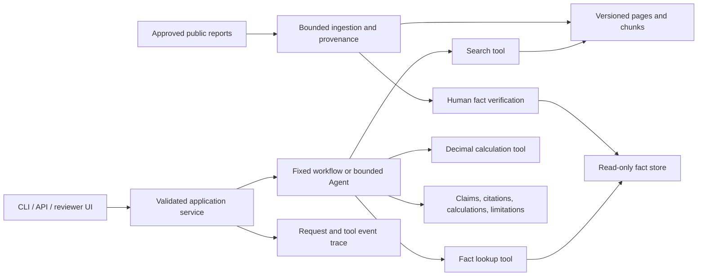

# Enterprise-oriented financial evidence application

Decision date: 2026-10-19. This is the target architecture and acceptance contract, not a statement that every component exists.

## Business workflow

A research analyst selects companies, reporting periods and imported reports; asks a factual or financial question; inspects cited source passages, verified input facts and deterministic calculations; exports a reproducible research brief. A reviewer can replay the same corpus/configuration and distinguish missing evidence, parse failure, unverified facts, incompatible accounting bases and model failure.

The initial financial scope is revenue, gross profit and gross margin, with year-over-year change and percentage-point change. No investment recommendations, trading accounts or forecasting claims.

The user's final interface pass (2026-10-19) calls for a minimal, human-friendly enterprise visual style: neutral colors, clear typography, balanced layout, compact tables and evidence panels. Design the actual reviewer workflow first; then check responsive, keyboard, loading, empty and error states in a real browser. Do not fill the screen with generic AI cards, gradients, decorative badges or marketing language.

## Design choices

Use a modular monolith first: one Python service layer shared by CLI, later FastAPI and a restrained reviewer-facing interface. Keep ingestion, retrieval, facts/calculations, orchestration and presentation separate. SQLite is sufficient for local metadata/facts/traces initially; adopt PostgreSQL only after a measured concurrency or operational requirement. A single bounded Agent follows a deterministic workflow baseline. Microservices, Kubernetes and multiple Agents are not prerequisites for credible engineering.

## Contracts and trust boundaries

- Input documents and model responses are untrusted data. Enforce types, sizes, deadlines, canonical paths and allowed domains at ingestion. PDF parsing is sandboxed or isolated with a bounded worker when added.
- Document provenance: source URL, byte SHA256, company, report period/type, publication date, import time, parser version, 1-based physical page and optional printed page. Synthetic pages use a different page kind.
- Retrieval filters are query controls, **not authorization**. When authenticated document access is implemented, server-derived permissions must be intersected before retrieval and revalidated before returning citations; test cross-user leakage.
- Output contract: schema_version, trace_id, mode, status, answer, claims, citations, calculations, limitations. Retrieval-only mode keeps answer null and does not invent claims.
- Citation existence and excerpt matching establish structural provenance, not semantic support. Evaluate support separately with human labels.
- Fact contract includes raw/normalized values, Decimal-compatible encoding, unit scale, currency, period, accounting basis, consolidation scope, provenance and review status. Only verified facts enter formal real-data calculations. The current synthetic_calculation mode uses separately labelled synthetic_fixture records with verified_by=null; it cannot accept human_verified labels or establish real-data quality.
- Tools are search_documents, get_financial_facts and calculate_metric. Parameterized read-only SQL; no generated executable code. Agent limits cover iterations, total calls, elapsed time, provider timeout and at most one format-repair attempt.
- Provider errors, invalid JSON, budget exhaustion and refusals are typed outcomes, not silent fallback answers. Offline stubs are labeled. Secrets remain in environment/secret stores; no full prompts or raw private documents in telemetry.

## Enterprise acceptance gates

| Dimension | Required demonstrable evidence | Present state |
|---|---|---|
| Correctness | Source-linked results; arithmetic edge cases; explicit failures | Source-checked synthetic retrieval, Decimal gross margin, annual revenue growth and margin percentage-point change; real review remains pending |
| Access boundaries | Authentication + server-side document authorization + negative tests | Not implemented; no hosted upload service |
| Reliability | Timeouts, bounded retry, idempotency, restart recovery tests | Local import contention refusal, idempotent retry and process-kill boundaries tested; full workflow recovery pending |
| Observability | Redacted tool spans, versioned corpus/config, categorized failures | Request identifier is an initial step, not full tracing |
| Evaluation | Frozen development/holdout splits, denominators, replayable results | Synthetic engineering tests only |
| Delivery | Clean-clone setup, CI, container smoke, rollback runbook | Incremental rollout; see STATUS |
| Operations | Measured load envelope and failure drills | Not measured; no uptime/SLA claim |

Performance targets are provisional: report p50/p95, sample size, corpus size, concurrency, hardware and cold/warm state before selecting an SLO. Never fabricate an enterprise availability number.

## Completion definition

The portfolio release needs a working report-to-evidence-to-calculation workflow, a separately demonstrated bounded model integration when authorized, reproducible evaluation and failure cases, CI and runnable packaging, an operations runbook, a three-minute demo and honest contribution records. A production deployment would additionally require organization-specific security, data licensing, privacy, capacity and operational review. Neither is established merely by writing this design.

## Current synthetic storage boundary (2026-10-21)

The CLI can explicitly build a local SQLite snapshot from source-checked synthetic facts. Three financial workflows select either the original JSON manifest or this snapshot, then share the same selected-source checks and Decimal functions. The reader accepts only the supported bounded schema through a mode=ro connection and parameterized internal queries. Builds create new snapshots; calculations neither update nor silently regenerate them. This implements a storage boundary, not the target human review, authorization or tracing systems. See FACT_STORE for failure/rebuild semantics.

## Released workbench boundary, 2026-10-21

The GitHub Pages client executes a validated, public synthetic bundle and has no server credential. The loopback server reuses Workspace/workflow and exposes only fixed static paths and one CSRF-checked operation endpoint. A bounded model loop selects allowlisted tools within the UI-selected scope. Financial answers originate in Decimal tools. Per-request tool results can be exported; browser checks are not signed verification. Read WORKBENCH_DESIGN and WORKBENCH_RUNBOOK before extending this boundary.

Local model decision failures expose only fixed category codes and call ordinals; the request owns its diagnostic list. Records survive a permitted format repair or subsequent provider failure, but raw rejected content is never copied into diagnostics. This is request-response observability, not persistent enterprise audit. See AGENT_DIAGNOSTICS.

## Bounded evidence handoff

`web/replay.mjs` owns the versioned deterministic package and verifier. `web/handoff.mjs` owns local File/Download UI only; `app.mjs` supplies current resolved request/review state. Both public and local pages recompute with the already-validated browser engine, preserving its Python parity contract. This avoids conflating native model execution logs with normalized deterministic snapshots. No upload endpoint, provider call, imported-state write or new dependency is introduced. HANDOFF_REPLAY documents version/data trust, refusal, size/depth bounds, preview truncation and unsigned annotations.

## Unverified PDF intake boundary

The public/loopback browser can locally inspect PDF files using pinned PDF.js in a dedicated Worker. Byte identity and physical-page text are exported as a separate unverified inventory. No user PDF is sent to the Python server, model, synthetic bundle, fact store or replay verifier. File reads, parser tasks and display/download state belong to one attempt; cancellation/deadline destroys its Worker. Byte/page/text caps are acceptance controls, not a hard process-memory guarantee. See PDF_INTAKE.

## Source-bound fact drafting

The PDF preflight now exposes an in-memory worksheet and unsigned unverified handoff. `fact-draft.mjs` owns typed/excerpt/decimal-string validation and collection reconstruction; `fact-draft-panel.mjs` owns DOM state. A closure supplies the current preflight report, and file replacement revokes the collection. These drafts cannot enter financial tools, replay or the trusted corpus. See FACT_DRAFTS for exact metadata and trust limits.

## Reference catalog boundary (2026-10-24)

`source-catalog.mjs` holds frozen official reference metadata. `inspectPdf` derives
a catalog match from actual bytes (SHA-256 + size), and `pdf-panel` renders safe-text
identity alongside physical pages. Draft export recomputes the reference, separate
from user-supplied company/period/units. Neither catalog membership nor exported
JSON authorizes calculation or constitutes authenticated approval. No extra
fetch/upload/model path; the Python static asset allowlist serves the same module.
See SOURCE_CATALOG for source provenance, first failures and limits.

## Original-page inspection (2026-10-24)

The optional preview opens the already selected local File in a separately owned
PDF.js Worker, verifies the preflight byte digest and renders one bounded canvas.
Selection/cancel revokes the attempt; successful rendering does not mutate drafts,
review flags or exports. PDF_PREVIEW documents resource/fidelity limitations.
